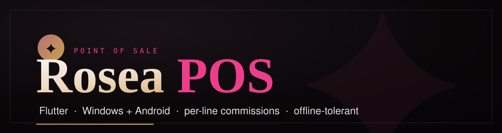
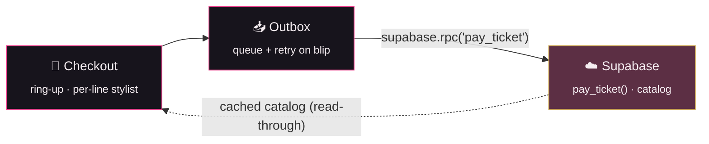

<p align="center">
  
</p>

<p align="center">
  
  
  
  
</p>

<p align="center">
  <b>The in-salon Point of Sale for Rosea.</b><br>
  <sub>One Flutter codebase → Windows desktop + Android. Rings up sales, credits each stylist, takes payment.</sub>
</p>

<p align="center">
  <a href="https://github.com/GaryCharbel/rosea">Platform / backend ↗</a> ·
  <a href="https://github.com/GaryCharbel/rosea/blob/main/docs/ROADMAP.md">Roadmap ↗</a> ·
  <a href="CLAUDE.md">Rulebook</a>
</p>

---

## ✦ What it does

A fast, counter-ready till: build a ticket from the catalog, **assign who performed each line**, apply a discount, take a **split payment** (cash / card / other) plus **tips**, print a receipt — and the backend records each stylist's commission automatically. Online bookings land here live.



## ⚡ Highlights

- **Windows + Android** from one codebase — platform bits (printing) behind abstractions.
- **Light resilience** — cached catalog + an idempotent retry queue; a WiFi blip never blanks the till or loses a sale (no offline-selling engine).
- **Money is exact** — all money-affecting writes go through one atomic, idempotent `pay_ticket()` RPC on the backend; the app never does ad-hoc money writes.
- **Cashiers never see commission rates** — the till reads a rate-free `staff_public` view.

## 🚀 Getting started (local)

> Needs the local backend running from the **[`rosea`](https://github.com/GaryCharbel/rosea)** repo (`npx supabase start`).

```bash
flutter pub get
cp env/test.json env/local.json      # then fill local.json with your local Supabase URL + anon key
flutter run -d windows --dart-define-from-file=env/local.json
# Android:
flutter run -d <device> --dart-define-from-file=env/local.json
```

Config is injected via `--dart-define-from-file`; the app **fails fast with an actionable message** if it's missing (`lib/env.dart`). Secrets never live in git.

## 🧪 Tests & CI

```bash
flutter analyze
flutter test --dart-define-from-file=env/test.json
```

CI on every PR: `analyze` + `test` + verify **both** targets build (`flutter build windows` + `flutter build apk`) — red blocks the merge. On release, CI builds a **Windows zip + an Android APK** and uploads both to the MEGA folder.

## 📦 Releasing

Cut a release by pushing an **annotated** version tag — the tag message becomes the changelog line:

```bash
git tag -a v1.0.2 -m "added customer support"
git push origin v1.0.2
```

CI then:
1. builds the **Android APK** + **Windows zip**,
2. creates the MEGA folder if it doesn't exist,
3. **deletes the previous version** (only the latest build is kept),
4. uploads the new build, and
5. **bumps `CHANGELOG.txt`** on MEGA — a running history, e.g.:

```
Rosea POS — Release History
===========================

v1.0.1  —  added discounts          (2026-10-30)
v1.0.2  —  added customer support   (2026-11-05)
```

A Discord embed reports the published release. (`CHANGELOG.txt` persists across releases; the build artifacts don't.)

## 📏 Ground rules

Never commit to `main` · nothing merges without review · CI gates every PR · **correctness → reliability → speed** · zero N+1 · never let the UI look flat. Full set → [`CLAUDE.md`](CLAUDE.md).

<sub>Built by <b>Gary Charbel El Hadchity</b>.</sub>
